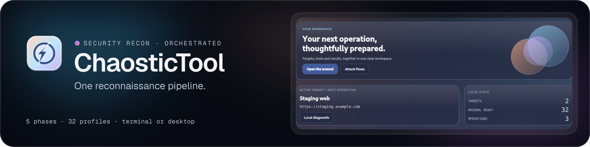
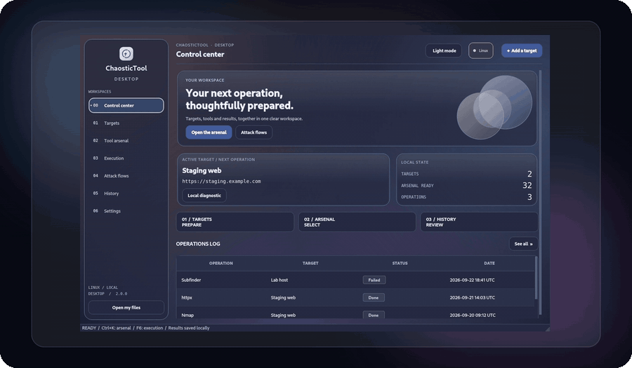
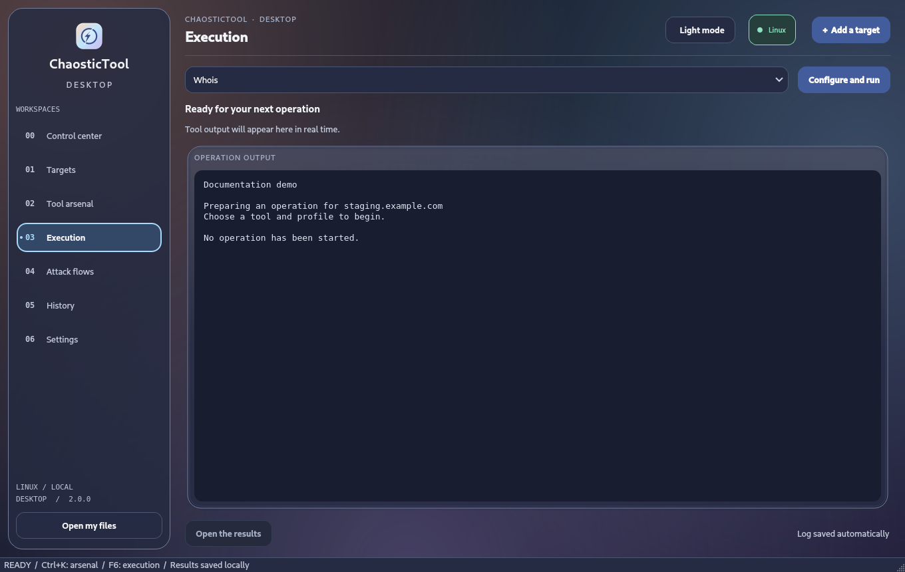
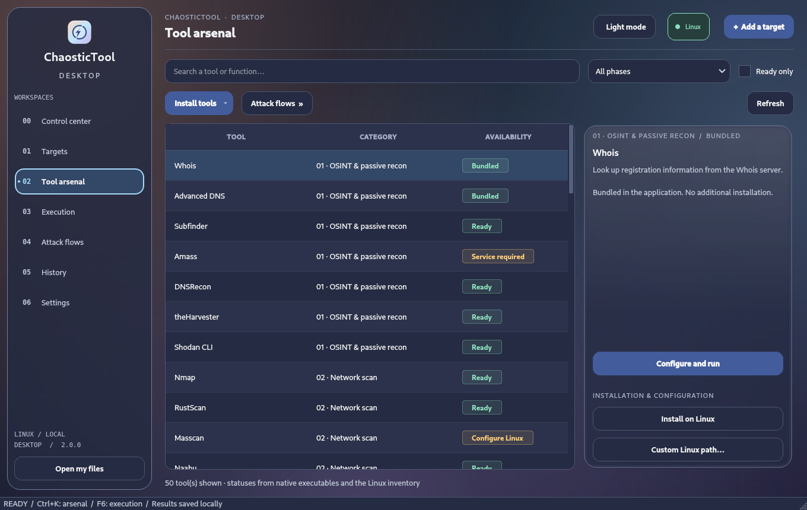
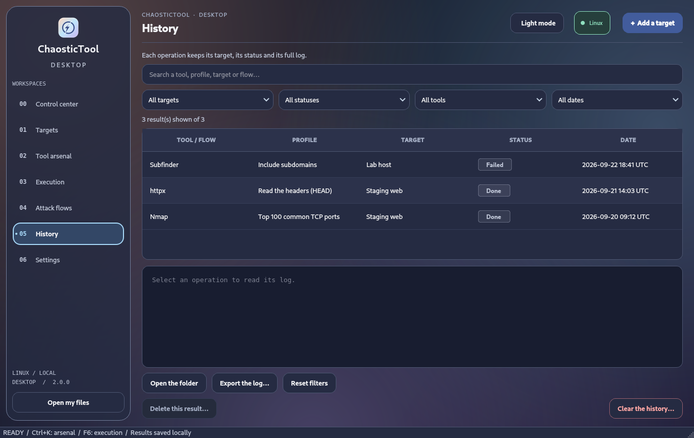
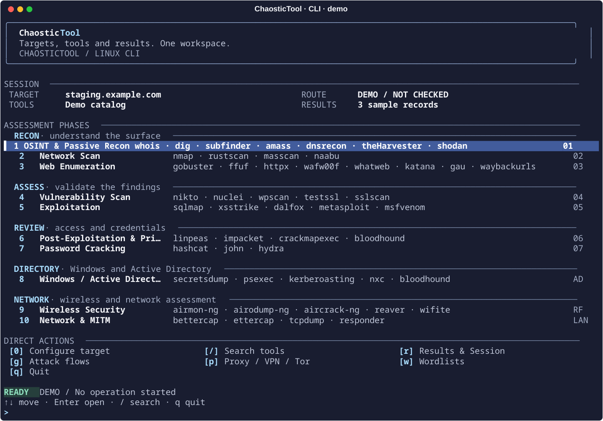
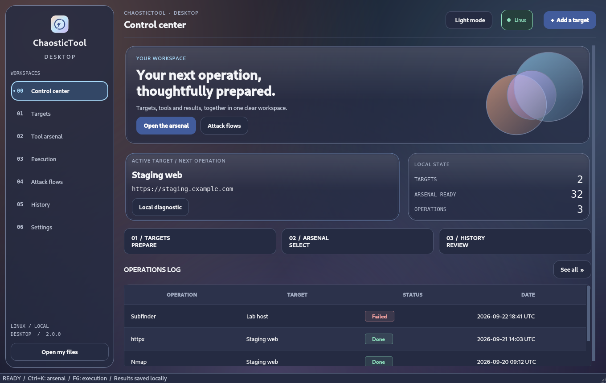

<p align="center">
  <picture>
    <source media="(prefers-color-scheme: light)" srcset="docs/media/banner.png">
    
  </picture>
</p>

<p align="center">
  <a href="https://github.com/Chaos-Tic/Chaostic-Tool/actions/workflows/ci.yml"></a>
  <a href="https://github.com/Chaos-Tic/Chaostic-Tool/releases"></a>
  <a href="LICENSE"></a>
</p>

# ChaosticTool

**One reconnaissance pipeline. Terminal precision or liquid glass control.**

> *Why ChaosticTool?* In chaos theory, deterministic chaos demonstrates that
> intricate, unpredictable behaviors emerge from simple, interconnected rules.
> Fitting for a security tool by [Chaos-Tic](https://github.com/Chaos-Tic):
> orchestrating dozens of disjointed offensive primitives into structured,
> deterministic intelligence where chaotic attack surfaces resolve into clarity.

<p align="center">
  <picture><source media="(prefers-color-scheme: light)" srcset="docs/media/hero.gif"></picture>
</p>

ChaosticTool bridges the gap between raw command-line auditing and graphical operations.
Whether you are auditing an external perimeter from an SSH bastion or leading an internal
Active Directory assessment from your workstation, ChaosticTool delivers the same unified
engine through two complementary interfaces:

- **Terminal Precision (`chaostictool`)**: Fullscreen Rich TUI navigator. Direct argument vectors, POSIX pseudo-terminal (`pty`) allocation and target-isolated local output.
- **Liquid Glass Desktop (`chaostictool-desktop`)**: Frosted-glass application with hardware-accelerated translucent surfaces (Light Pastel & Midnight Neon palettes). Visual flow sequencing, live VT100 terminal monitor, and mission history management.

Everything runs strictly on your machine. No accounts, no telemetry, no cloud dependencies.
The only optional network call is a once-a-day check for a newer GitHub release, which can be
disabled at any time in settings.

**Version 2.0.0 is under development.** The unified packages and release workflow are
validated in this branch but are not claimed as published distribution channels. The
latest public releases still contain the earlier split CLI and Desktop editions.

[Project website](https://tool.chaostic.cloud/cybersecurite.html) · [Install](#install) · [How it works](#how-it-works) · [Phases and profiles](#phases-and-profiles) · [Architecture](docs/ARCHITECTURE.md) · [User guide](docs/USER_GUIDE.md) · [Compatibility](docs/COMPATIBILITY.md) · [Troubleshooting](docs/TROUBLESHOOTING.md) · [Verifying](docs/VERIFYING.md)

---

## How it works

<table>
<tr>
<td width="50%"><picture><source media="(prefers-color-scheme: light)" srcset="docs/media/liquid-glass-accueil.png"></picture></td>
<td width="50%"><picture><source media="(prefers-color-scheme: light)" srcset="docs/media/liquid-glass-execution.png"></picture></td>
</tr>
<tr>
<td><b>1. Scope & Target.</b> Define domains, IPv4/IPv6 addresses, CIDR blocks, or URLs. Targets are validated and isolated in private local storage without launching unwanted connections.</td>
<td><b>2. Orchestrated Execution.</b> Launch individual profiles or chained flows. Interactive tools run in dedicated pseudo-terminals with real-time output and instant cancellation.</td>
</tr>
<tr>
<td width="50%"><picture><source media="(prefers-color-scheme: light)" srcset="docs/media/liquid-glass-arsenal.png"></picture></td>
<td width="50%"><picture><source media="(prefers-color-scheme: light)" srcset="docs/media/liquid-glass-historique.png"></picture></td>
</tr>
<tr>
<td><b>3. Shared tool arsenal.</b> Forty-six CLI tools and 136 launch profiles are categorized across ten phases; Desktop adds four built-in utilities and platform adapters.</td>
<td><b>4. Intelligence & Audit.</b> Review parsed findings, inspect raw chunk logs, or export structured JSON reports. Atomic history clearing prevents symlink directory traversal.</td>
</tr>
</table>

---

## Two Interfaces, One Shared Core

ChaosticTool is converging both interfaces on one registry, release model and
UI-independent process runner. Cross-adapter tests currently prove matching success,
failure, literal argv, large-output, cancellation, timeout and streamed-redaction
behaviour. Routing and flows are not yet exposed with full interface parity.

| Capability | Terminal Precision CLI / TUI (`chaostictool`) | Liquid Glass Desktop GUI (`chaostictool-desktop`) |
| --- | --- | --- |
| **Primary Environment** | Headless servers, SSH sessions, minimal containers, Linux terminals | Graphical workstations (Linux X11/Wayland & Windows) |
| **Interface Style** | Rich terminal TUI dashboard & direct shell commands | Frosted glass with light pastel & dark neon themes |
| **Execution Sandboxing** | Dedicated POSIX `pty` pseudo-terminals with zero orphan processes | Integrated VT100 terminal widget with ANSI color emulation |
| **Routing Controls** | Persistent HUD: Direct, Tor (with auto-rotation), and VPN guard | Not exposed yet; GUI routing controls are tracked work |
| **Automation & CI** | Interactive TUI; machine-readable profile execution is tracked work | Visual chained flow designer with step dependencies |
| **Windows Support** | Linux CLI through WSL2 | Native installer with automated WSL2 Kali Linux backend |

---

### Terminal Precision CLI (`chaostictool`)

A high-density terminal control surface built with Rich and prompt_toolkit for keyboard-first security operators and headless environments:

<p align="center">
  <picture>
    <source media="(prefers-color-scheme: light)" srcset="docs/media/cli-light.png">
    
  </picture>
</p>

- **Live Workspace HUD**: Always-visible status header tracking active target, routing interface (`DIRECT`, `TOR via proxychains`, `VPN`), and target-isolated output directories.
- **Kill-Chain Methodology**: 10 offensive categories organized into structured phases (OSINT, Network Scan, Web Enumeration, Vulnerability Scan, Exploitation, Post-Exploit, Password Cracking, Windows / Active Directory, Wireless, Network & MITM).
- **Direct Action Dock**: Single-keystroke navigation for target configuration (`[0]`), fuzzy tool catalog search (`[/]`), saved results & session browser (`[r]`), Proxy/VPN/Tor routing controls (`[p]`), and guided attack flows (`[g]`).
- **Terminal-first operation**: Launch the interactive TUI without a graphical session and use the maintenance checks independently:
  ```bash
  # Launch the interactive terminal control surface
  sudo chaostictool

  # Check the installed runtime without network access or root
  chaostictool --check-installation

  # Check for updates from GitHub releases
  chaostictool --check-updates
  ```

---

### Liquid Glass Desktop (`chaostictool-desktop`)

A fluid desktop application crafted with the Chaos-Tic frosted-glass aesthetic for graphical Linux workstations and Windows:

<p align="center">
  
</p>

- **Frosted-Glass Visual Language**: Translucent layered cards, inner reflections, and dual palettes (Light Pastel & Midnight Neon) with high-contrast sans-serif typography and reduced-transparency accessibility.
- **Visual Flow Orchestration**: Sequence multi-tool recon and audit workflows with automatic parameter propagation and dependency checks.
- **Integrated VT100 Terminal Monitor**: Watch live tool execution in an embedded terminal emulator with full ANSI styling, elapsed timers, and clean cancellation.
- **Cross-Platform Distribution**: A unified package is built for Debian/Ubuntu and Fedora, alongside Arch packaging, AppImage, Windows and macOS artifacts. See the dated compatibility table for what CI actually verifies and the installation guide for channel availability.

---

## Phases and Profiles

ChaosticTool shares one ordered set of ten phases across both interfaces:

| Phase | Core Objective | Integrated Profiles |
| --- | --- | --- |
| **01. OSINT** | Passive discovery and public records | `whois`, `dig`, `subfinder`, `amass`, `dnsrecon`, `theHarvester`, `shodan` |
| **02. Network scan** | Host, port and service discovery | `nmap`, `rustscan`, `masscan`, `naabu` |
| **03. Web enumeration** | HTTP probing, crawling and content discovery | `gobuster`, `ffuf`, `httpx`, `wafw00f`, `whatweb`, `katana`, `gau`, `waybackurls` |
| **04. Vulnerabilities** | Web, TLS and template-based checks | `nikto`, `nuclei`, `wpscan`, `testssl.sh`, `sslscan` |
| **05. Exploitation** | Explicitly selected exploitation workflows | `sqlmap`, `xsstrike`, `dalfox`, `msfconsole`, `msfvenom` |
| **06. Post-exploitation** | Credential, remote execution and graph collection workflows | Impacket tools, `NetExec` and `bloodhound-python` |
| **07. Passwords** | Offline and online password auditing | `hashcat`, `john`, `hydra` |
| **08. Windows / AD** | Windows and Active Directory assessment | Impacket tools, `NetExec`/legacy CME, `bloodhound-python` |
| **09. Wi-Fi** | Wireless discovery and authorized auditing | Aircrack-ng tools, `reaver`, `wifite` |
| **10. Network & MITM** | Packet capture and authorized local-network testing | `bettercap`, `ettercap`, `tcpdump`, `responder` |

---

## Install

The commands below describe the **2.x target channels**. Do not assume AUR, COPR,
APT or unified GitHub assets exist until a public 2.x release announces them; for the
development tree, use the source instructions at the end of this section.

### Arch Linux (AUR)
```bash
# Unified CLI + Desktop package
yay -S chaostictool
```

### Fedora / Red Hat (COPR)
```bash
sudo dnf copr enable chaostic/chaostictool
sudo dnf install chaostictool
```

### Debian / Ubuntu
After a 2.x release is published, download its native `.deb`:
```bash
sudo apt install ./chaostictool_2.0.0_amd64.deb
```
Or via the Chaos-Tic signed APT repository:
```bash
sudo curl -fsSLo /usr/share/keyrings/chaos-tic.gpg https://chaos-tic.github.io/apt/chaos-tic-apt.gpg
printf '%s\n' 'deb [signed-by=/usr/share/keyrings/chaos-tic.gpg] https://chaos-tic.github.io/apt stable main' | sudo tee /etc/apt/sources.list.d/chaos-tic.list
sudo apt update && sudo apt install chaostictool
```

### Universal Linux (AppImage)
```bash
chmod +x ChaosticTool-2.0.0-x86_64.AppImage
./ChaosticTool-2.0.0-x86_64.AppImage
```

### Windows 10 & 11
After a 2.x release is published, download `ChaosticTool-Setup-2.0.0-windows-x64.exe`
from [Releases](https://github.com/Chaos-Tic/Chaostic-Tool/releases).
The installer sets up the desktop launcher and offers an automated Kali Linux WSL2 integration
for running Linux-native security utilities with zero manual configuration.

### Build from Source
```bash
git clone https://github.com/Chaos-Tic/Chaostic-Tool.git
cd Chaostic-Tool

# Install Python dependencies
pip install -r requirements.txt -r requirements-desktop.txt

# Run the interactive CLI directly
sudo python chaostictool.py

# Run Desktop directly
python chaostic_desktop.py

# Or build native CMake packages (.deb, .rpm, .tar.gz)
cmake -B build -DCMAKE_INSTALL_PREFIX=/usr
cmake --build build
cpack --config build/CPackConfig.cmake -G "DEB;RPM" -B release
```

---

## Security & Privacy Discipline

ChaosticTool adheres to the privacy and security principles of the [Chaos-Tic](https://github.com/Chaos-Tic) ecosystem:

- **Local-First Execution**: Findings, credentials, and targets are never uploaded to any cloud service.
- **Sensitive-data boundaries**: Desktop and CLI mask configured secret fields in command
  previews and streamed values before persistence, including values split across output
  chunks. Operators must still treat all local logs as sensitive.
- **Safe Directory Operations**: The storage manager enforces strict filesystem boundaries, rejecting symbolic link traversal or directory junctions during log deletion (`CVE-resistant cleanup`).
- **No Shell Interpolation**: Subprocesses are spawned directly using explicit argument arrays, preventing command-injection attacks through untrusted target names.

---

## Documentation

- **[Architecture & Internals](docs/ARCHITECTURE.md)**: Process model, PTY allocation, and source map.
- **[User Guide](docs/USER_GUIDE.md)**: Command reference, flags, desktop walkthrough, and theme controls.
- **[Compatibility Matrix](docs/COMPATIBILITY.md)**: Tested operating systems, tool requirements, and package channels.
- **[Testing & CI](docs/TESTING.md)**: Unit tests, headless X11 visual contracts, and clean container validation.
- **[Troubleshooting](docs/TROUBLESHOOTING.md)**: Resolutions for common environment, permission, and terminal issues.
- **[Verifying Checksums](docs/VERIFYING.md)**: Cryptographic signature and SHA-256 validation instructions.

---

## License

Copyright (c) 2026 Chaos-Tic. This source tree is licensed under
**GPL-3.0-or-later** ([LICENSE](LICENSE)). Releases published before this change remain
available under the license that accompanied them; the change is not retroactive.
The project name and logo are governed separately by the
[trademark policy](TRADEMARKS.md).
