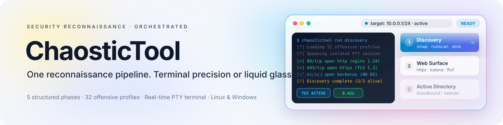
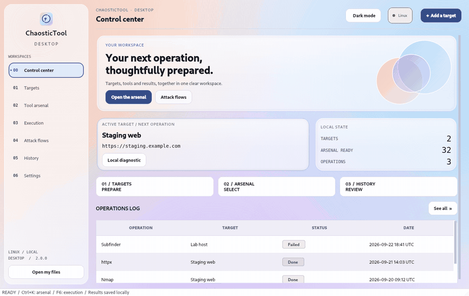
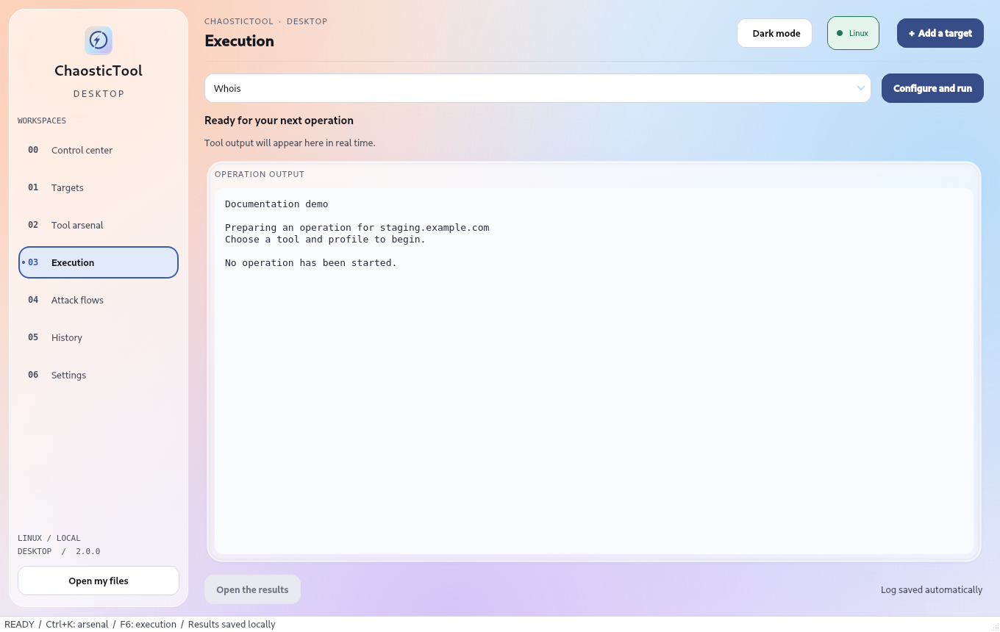
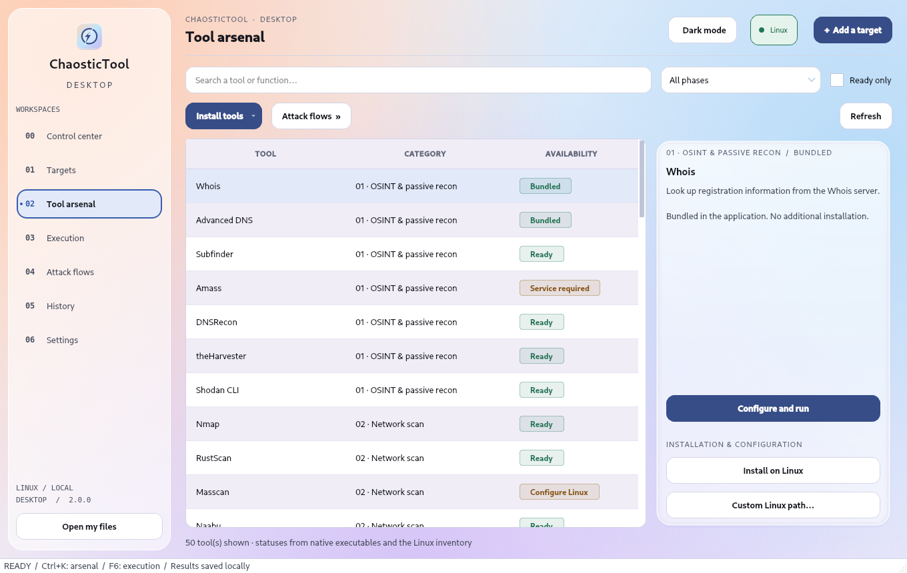

<p align="center">
  <picture>
    <source media="(prefers-color-scheme: dark)" srcset="docs/media/banner-dark.svg">
    
  </picture>
</p>

<p align="center">
  <a href="https://github.com/Chaos-Tic/Chaostic-Tool/actions/workflows/ci.yml"></a>
  <a href="https://github.com/Chaos-Tic/Chaostic-Tool/releases"></a>
  <a href="LICENSE"></a>
</p>

# ChaosticTool

**One reconnaissance pipeline. Terminal precision or liquid glass control.**

> *Why ChaosticTool?* In chaos theory, deterministic chaos demonstrates that
> intricate, unpredictable behaviors emerge from simple, interconnected rules.
> Fitting for a security tool by [Chaos-Tic](https://github.com/Chaos-Tic):
> orchestrating dozens of disjointed offensive primitives into structured,
> deterministic intelligence where chaotic attack surfaces resolve into clarity.

<p align="center">
  
</p>

ChaosticTool bridges the gap between raw command-line auditing and graphical operations.
Whether you are auditing an external perimeter from an SSH bastion or leading an internal
Active Directory assessment from your workstation, ChaosticTool delivers the same unified
engine through two complementary interfaces:

- **Terminal Precision (`chaostictool`)**: Fullscreen Rich TUI navigator or scriptable CLI. Direct argument expansion, POSIX pseudo-terminal (`pty`) allocation, secret redaction, and clean JSON Lines output.
- **Liquid Glass Desktop (`chaostictool-desktop`)**: Frosted-glass application with hardware-accelerated translucent surfaces (Light Pastel & Midnight Neon palettes). Visual flow sequencing, live VT100 terminal monitor, and mission history management.

Everything runs strictly on your machine. No accounts, no telemetry, no cloud dependencies.
The only optional network call is a once-a-day check for a newer GitHub release, which can be
disabled at any time in settings.

**Version 2.0.0.** Install it with your distribution's package manager, [from source](#install),
or from the [latest release](https://github.com/Chaos-Tic/Chaostic-Tool/releases/latest).

[Install](#install) · [How it works](#how-it-works) · [Phases and profiles](#phases-and-profiles) · [Architecture](docs/ARCHITECTURE.md) · [User guide](docs/USER_GUIDE.md) · [Compatibility](docs/COMPATIBILITY.md) · [Troubleshooting](docs/TROUBLESHOOTING.md) · [Verifying](docs/VERIFYING.md)

---

## How it works

<table>
<tr>
<td width="50%"></td>
<td width="50%"></td>
</tr>
<tr>
<td><b>1. Scope & Target.</b> Define domains, IPv4/IPv6 addresses, CIDR blocks, or URLs. Targets are validated and isolated in private local storage without launching unwanted connections.</td>
<td><b>2. Orchestrated Execution.</b> Launch individual profiles or chained flows. Interactive tools run in dedicated pseudo-terminals with real-time output and instant cancellation.</td>
</tr>
<tr>
<td width="50%"></td>
<td width="50%"></td>
</tr>
<tr>
<td><b>3. Arsenal of 32 Profiles.</b> Categorized across 5 offensive phases: Discovery, Web Surface, Exposure & Secrets, Active Directory, and Intelligence Reporting.</td>
<td><b>4. Intelligence & Audit.</b> Review parsed findings, inspect raw chunk logs, or export structured JSON reports. Atomic history clearing prevents symlink directory traversal.</td>
</tr>
</table>

---

## Two Interfaces, One Shared Core

| Capability | Terminal CLI / TUI (`chaostictool`) | Liquid Glass GUI (`chaostictool-desktop`) |
| --- | --- | --- |
| **Primary Environment** | Headless servers, SSH sessions, minimal containers | Graphical workstations (Linux X11/Wayland & Windows) |
| **Interface Style** | Rich terminal dashboard & direct shell commands | Frosted glass with light pastel & dark neon themes |
| **Execution Sandboxing** | POSIX `pty` pseudo-terminal without shell wrappers | Integrated VT100 terminal widget with pyte emulation |
| **Automation & CI** | Scriptable with `--json` and exit-code propagation | Visual chained flow designer with step dependencies |
| **Windows Support** | Native PowerShell / WSL2 integration | Native installer with automated WSL2 Kali Linux backend |

---

## Phases and Profiles

ChaosticTool structures security reconnaissance into 5 deterministic phases:

| Phase | Core Objective | Integrated Profiles |
| --- | --- | --- |
| **1. Discovery** | Host discovery, port enumeration, service identification | `nmap` (Fast, Full, SYN, UDP), `rustscan`, `arp-scan`, `netdiscover` |
| **2. Web Surface** | HTTP probing, crawling, content discovery, technology fingerprinting | `httpx`, `katana`, `feroxbuster`, `ffuf`, `gobuster`, `nikto` |
| **3. Exposure & Secrets** | Subdomain discovery, passive OSINT, secret detection in repos | `subfinder`, `amass`, `trufflehog`, `gitleaks`, `dnsrecon` |
| **4. Active Directory** | Domain enumeration, Kerberos auditing, network share analysis | `bloodhound-python`, `netexec` (nxc), `ldapdomaindump`, `kerbrute` |
| **5. Reporting** | Synthesis, structured JSON extraction, audit documentation | Native synthesis engine, markdown summaries, HTML deliverables |

---

## Install

### Arch Linux (AUR)
```bash
# Full suite (CLI + Desktop)
yay -S chaostictool

# Headless CLI only
yay -S chaostictool-cli
```

### Fedora / Red Hat (COPR)
```bash
sudo dnf copr enable chaostic/chaostictool
sudo dnf install chaostictool chaostictool-desktop
```

### Debian / Ubuntu
Download the native `.deb` from the [latest release](https://github.com/Chaos-Tic/Chaostic-Tool/releases/latest):
```bash
sudo apt install ./chaostictool_2.0.0_amd64.deb
```
Or via the Chaos-Tic signed APT repository:
```bash
sudo curl -fsSL https://apt.chaos-tic.com/KEY.gpg -o /etc/apt/trusted.gpg.d/chaostic.gpg
echo "deb https://apt.chaos-tic.com/ stable main" | sudo tee /etc/apt/sources.list.d/chaostic.list
sudo apt update && sudo apt install chaostictool
```

### Universal Linux (AppImage)
```bash
chmod +x ChaosticTool-2.0.0-x86_64.AppImage
./ChaosticTool-2.0.0-x86_64.AppImage
```

### Windows 10 & 11
Download `ChaosticTool-Setup-2.0.0.exe` from [Releases](https://github.com/Chaos-Tic/Chaostic-Tool/releases/latest).
The installer sets up the desktop launcher and offers an automated Kali Linux WSL2 integration
for running Linux-native security utilities with zero manual configuration.

### Build from Source
```bash
git clone https://github.com/Chaos-Tic/Chaostic-Tool.git
cd Chaostic-Tool

# Install Python dependencies
pip install -r requirements.txt -r requirements-desktop.txt

# Run CLI directly
python chaostictool.py list

# Run Desktop directly
python -m desktop

# Or build native CMake packages (.deb, .rpm, .tar.gz)
cmake -B build -DCMAKE_INSTALL_PREFIX=/usr
cmake --build build
cpack --config build/CPackConfig.cmake -G "DEB;RPM" -B release
```

---

## Security & Privacy Discipline

ChaosticTool adheres to the privacy and security principles of the [Chaos-Tic](https://github.com/Chaos-Tic) ecosystem:

- **Local-First Execution**: Findings, credentials, and targets are never uploaded to any cloud service.
- **Credential Masking**: Terminal outputs are passed through real-time filter buffers that redact known secret patterns before persisting to disk.
- **Safe Directory Operations**: The storage manager enforces strict filesystem boundaries, rejecting symbolic link traversal or directory junctions during log deletion (`CVE-resistant cleanup`).
- **No Shell Interpolation**: Subprocesses are spawned directly using explicit argument arrays, preventing command-injection attacks through untrusted target names.

---

## Documentation

- **[Architecture & Internals](docs/ARCHITECTURE.md)**: Process model, PTY allocation, and source map.
- **[User Guide](docs/USER_GUIDE.md)**: Command reference, flags, desktop walkthrough, and theme controls.
- **[Compatibility Matrix](docs/COMPATIBILITY.md)**: Tested operating systems, tool requirements, and package channels.
- **[Testing & CI](docs/TESTING.md)**: Unit tests, headless X11 visual contracts, and clean container validation.
- **[Troubleshooting](docs/TROUBLESHOOTING.md)**: Resolutions for common environment, permission, and terminal issues.
- **[Verifying Checksums](docs/VERIFYING.md)**: Cryptographic signature and SHA-256 validation instructions.

---

## Licence

ChaosticTool is free and open-source software licensed under the **GNU General Public License v3.0** ([GPL-3.0](LICENSE)).
