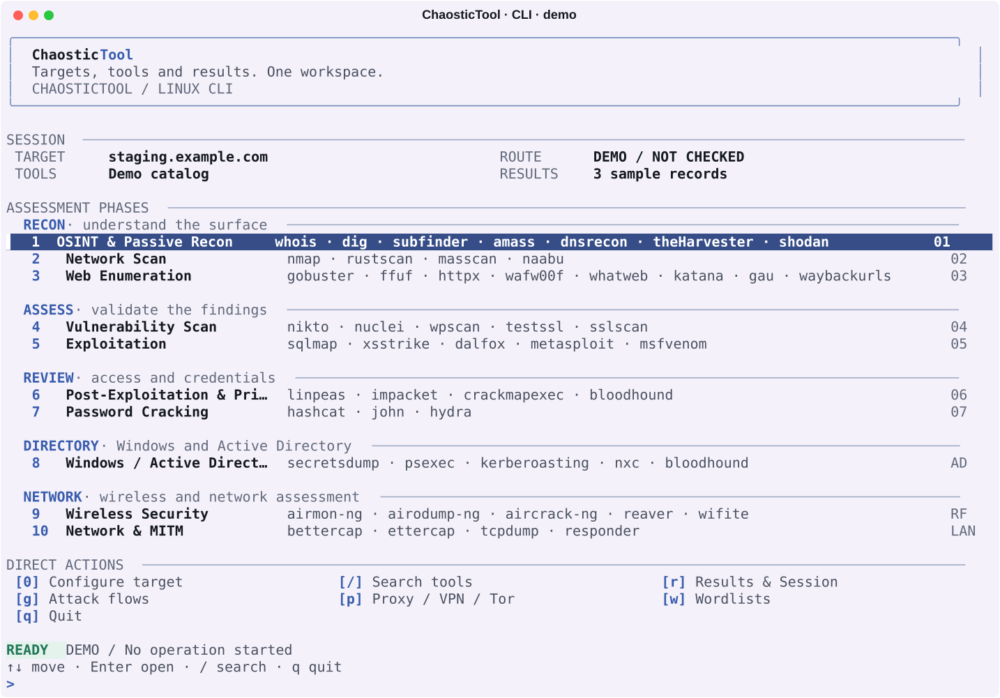
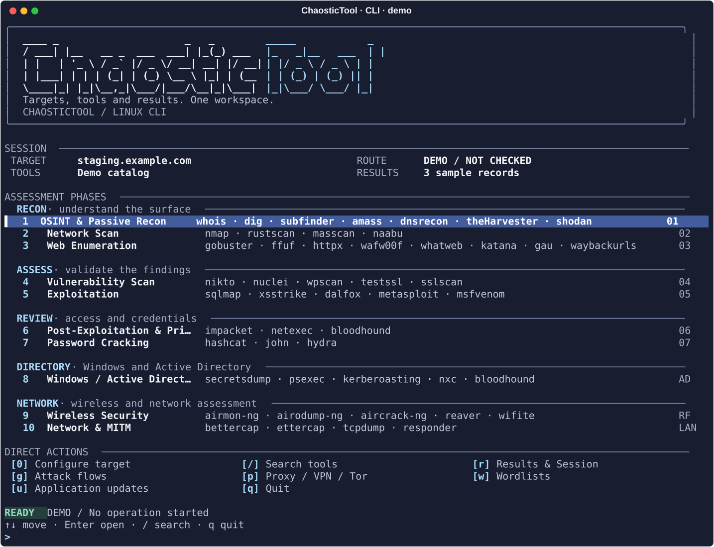

<div align="center">


# ChaosticTool

### Linux pentest control surface for structured recon, tool orchestration, routing control, and target-based evidence capture

[](https://github.com/Chaos-Tic/Chaostic-Tool/releases/tag/v1.4.0)
[](https://www.python.org/)
[](https://github.com/Textualize/rich)
[](#supported-systems)
[](LICENSE)

ChaosticTool is a Rich-powered terminal framework for authorized security testing. It centralizes common pentest tools, guided scan flows, target-aware output storage, and Tor/VPN routing controls into one fast interactive CLI.

</div>

---

## Choose your edition

| Edition | Branch | Start here |
|---|---|---|
| Linux terminal | [`linux-cli`](https://github.com/Chaos-Tic/Chaostic-Tool/tree/linux-cli) | CLI installation below; Python 3.11+ |
| Windows desktop | [`desktop/windows-app`](https://github.com/Chaos-Tic/Chaostic-Tool/tree/desktop/windows-app) | [Desktop 1.1.5, Windows x64 / ARM64](https://github.com/Chaos-Tic/Chaostic-Tool/releases/tag/desktop-v1.1.5) |
| Linux desktop | [`desktop/linux-app`](https://github.com/Chaos-Tic/Chaostic-Tool/tree/desktop/linux-app) | [Desktop 1.1.5 downloads](https://github.com/Chaos-Tic/Chaostic-Tool/releases/tag/desktop-v1.1.5) · [Linux GUI setup](https://github.com/Chaos-Tic/Chaostic-Tool/blob/desktop/linux-app/README_DESKTOP_LINUX.md) |

The CLI and desktop branches have separate entry points and installation paths.
The repository-root `install.sh` installs the **CLI**. The installer inside a
Desktop Linux archive installs the **GUI**. Desktop 1.1.5 also includes macOS
packages for Intel and Apple Silicon. All Desktop editions share the CLI-inspired
Red Ops identity: the original README mascot and wordmark, deep black surfaces,
red accents, numbered navigation and industrial frames.
The CLI keeps its own version (1.4.0) and terminal experience.

## Terminal appearance — development preview



The development interface follows the peach, sky and lilac visual family of the desktop application, adapted to a terminal: clear sections, rounded frames, explicit status labels and a visible selection. Terminals use opaque colors; compositor blur and glass transparency are not required. The screenshots contain synthetic data and do not represent a completed scan. This refresh is included in CLI 1.4.0.

The CLI uses the terminal's `COLORFGBG` hint when available and falls back to dark otherwise. Set `CHAOSTIC_THEME=light` or `CHAOSTIC_THEME=dark` to override detection for a launch. True color is used where supported; terminal libraries handle reduced color capabilities. The application does not change your terminal preferences.

With `prompt_toolkit` installed and an interactive terminal, menus run full screen. Arrow keys and Enter select a phase, `/` opens search, and the existing action shortcuts remain available. Non-interactive output or an unavailable TUI dependency uses the Rich fallback with the same palette. No-color output retains labels and selection markers.

<details>
<summary>Dark terminal preview</summary>



</details>

Generate the SVG previews without root access, startup checks, external commands or network requests:

```bash
CHAOSTIC_THEME=light python scripts/render-cli.py
CHAOSTIC_THEME=dark python scripts/render-cli.py
python -m unittest discover -s tests -v
```

## What Is Chaostic Tool?

ChaosticTool is a pentesting framework for authorized assessments: an operator-first CLI built around real security testing workflows and fast iteration. It brings a broad set of reconnaissance, enumeration, scanning, exploitation-support, post-exploitation, password, wireless, and network tools into one structured terminal experience.

The goal is not to hide what the underlying tools do. The goal is to make them faster to launch, easier to organize, safer to route, and cleaner to document during an assessment.

ChaosticTool gives you:

- one target context shared across modules;
- curated presets for common attack and recon steps;
- guided attack flows for repeatable multi-tool chains;
- automatic result storage by target and category;
- Tor/proxy and VPN guard visibility before launching tools;

## Why ChaosticTool

Most security testing sessions become messy fast: repeated commands, scattered outputs, forgotten flags, and unclear routing state. ChaosticTool is built to keep the operator focused by turning a Linux workstation into a structured terminal control surface.

It does not replace the underlying tools. It orchestrates them cleanly.

## Core Features

- Rich-based terminal UI with a persistent HUD for target, route, proxy, and version state.
- Phase-based methodology: OSINT, network scan, web enum, vuln scan, exploitation, post-exploitation, passwords, wireless, and MITM.
- Ready-to-run presets for tools such as `nmap`, `rustscan`, `gobuster`, `ffuf`, `httpx`, `nuclei`, `sqlmap`, `hydra`, `bettercap`, and more.
- Target-aware result storage under `~/.local/share/chaostictool/targets/<target>/`.
- Guided attack flows for basic, intermediate, and advanced recon chains.
- Tor routing through `proxychains` where operationally appropriate.
- VPN guard for `tun*`, `wg*`, and `ppp*` interfaces.
- Live execution feedback, command launch panels, exit summaries, and saved-result indicators.
- Startup tool check with optional installation of missing dependencies.
- Clean interrupt handling: `Ctrl+C` stops the running tool without leaving ChaosticTool child processes behind.

## Supported Systems

ChaosticTool targets Linux distributions commonly used for security work:

| Family | Status | Notes |
| --- | --- | --- |
| Arch / Manjaro | Supported | Uses `pacman`; full profile builds AUR packages directly with `makepkg` after installing `pacman`, `git`, and `base-devel`. |
| Debian / Ubuntu | Supported | Uses `apt`. |
| Kali / Parrot | Supported | Debian-based workflow. |
| Fedora | Supported | Uses `dnf`. |

Several integrated tools require elevated privileges, so ChaosticTool is intended to run with `sudo`.

## Native packages

CLI 1.4.0 includes native DEB/RPM packages and source packaging for
AUR, COPR and Ubuntu. Repository channels are being verified separately. The package installs the interface and its Python
runtime dependencies. Assessment tools remain optional and can be installed individually.

For a downloaded package, use the package manager so dependencies are resolved:

```sh
sudo apt install ./chaostictool_1.4.0_all.deb
# or Fedora:
sudo dnf install ./chaostictool-1.4.0-1.noarch.rpm
chaostictool --check-installation
sudo chaostictool
```

Remove package installations with `apt remove chaostictool`, `dnf remove chaostictool`
or `pacman -R chaostictool`. The legacy `uninstall.sh` is for legacy script installs.
User results are preserved when removing a package.

CMake installs source files without downloading tools or Python packages. Install
Python 3.11+, Rich 13.7+ and prompt_toolkit 3+ through your distribution first:

```sh
cmake -S . -B build/native -DCMAKE_INSTALL_PREFIX=/usr/local
sudo cmake --install build/native
# Packaging/staging, without touching the host filesystem:
DESTDIR="$PWD/staging" cmake --install build/native
# Optional DEB or RPM (requires dpkg-deb or rpmbuild):
cpack --config build/native/CPackConfig.cmake -G DEB
```

Results now live in `$XDG_DATA_HOME/chaostictool/targets` (default
`~/.local/share/chaostictool/targets`). Under sudo, the invoking user's home is used
and new directories are owned by that user. `CHAOSTIC_CLI_HOME=/absolute/path` can
override the location for a non-root launch. Existing source-checkout results stay
where they are: copy them into the new targets directory when ready. Legacy custom
flows are read if no per-user file exists; subsequent saves use the per-user file.

## Installation from a checkout

```bash
git clone --branch linux-cli https://github.com/Chaos-Tic/Chaostic-Tool.git
cd Chaostic-Tool
sudo ./install.sh
sudo chaostictool
```

The default installer uses the `standard` profile: it installs the Python runtime, `rich`, the ChaosticTool launcher, and fast official distro packages where available. It deliberately avoids source builds and large optional stacks by default.

Supported installer options:

```bash
sudo ./install.sh --profile minimal      # Python/Rich + launcher only
sudo ./install.sh --profile standard     # default: official distro packages only
sudo ./install.sh --with-tor             # Tor/proxychains for minimal/standard profiles
sudo ./install.sh --profile full         # heavy Go/Cargo/pipx/pip/gem/source/AUR installs + Tor routing
```

Additional opt-in options are `--with-kali-repo` (apt systems),
`--with-chaotic-aur` (pacman systems), and `--no-tools`. `./install.sh --help`
describes every option. Extra repositories change the system package sources;
they are not needed for the default installation. Prefer a dedicated assessment
environment when using them. Installs record their changes in
`/var/lib/chaostictool/manifest` for the uninstaller.

The installer detects `pacman`, `apt`, `dnf`, `zypper`, or `apk`, skips unavailable packages instead of failing the whole run, and links registered user-installed Go, Cargo, pipx, pip, and local binaries into paths visible from root shells.

The installation, especially the full version, may take some time because it will install the 50+ tools required for it to work properly, unless they are already installed.

On ARM systems such as Raspberry Pi OS, the `full` profile uses portable fallbacks for tools that are often absent from the default repositories. Metasploit can still remain unavailable unless the system exposes a compatible `metasploit-framework` package.

## Uninstallation

```bash
sudo ./uninstall.sh
```

The uninstaller removes, in order:

- the `/usr/local/bin/chaostictool` launcher;
- source-install wrappers (`responder`, `whatweb`, `xsstrike`) and Python-module wrappers (`secretsdump.py`, `psexec.py`, `GetUserSPNs.py`) from `/usr/local/bin`;
- direct-download assets (`linpeas.sh`, `winpeas.exe`, `rustscan` release binary);
- symlinks to user-local tool directories (`~/go/bin`, `~/.cargo/bin`, `~/.local/bin`) that the installer created;
- the `/opt/chaostictool/` source checkouts and `/var/cache/chaostictool/` build staging area;
- Tor and proxychains config modifications, restoring originals from the `.chaostictool.bak` backups.

For Go, Cargo, pipx, and gem tools, the uninstaller asks for confirmation before removing each group. System packages installed via `pacman`, `apt`, or `dnf` are listed at the end for manual review — they are never removed automatically.

The project directory itself is not touched. Remove it manually once the uninstaller has run:

```bash
sudo rm -rf Chaostic-Tool/
```

## Quick Start

1. Launch ChaosticTool:

```bash
sudo chaostictool
```

2. Select `0` to configure a target.

3. Move through the methodology:

```text
1  OSINT & Passive Recon
2  Network Scan
3  Web Enumeration
4  Vulnerability Scan
5  Exploitation
6  Post-Exploitation & Privesc
7  Password Cracking
8  Windows / Active Directory
9  Wireless Security
10 Network & MITM
```

4. Use `11` to browse saved results.

5. Use `12` to run guided attack flows.

6. Use `p` to control Proxy / VPN / Tor routing.

Navigation:

```text
r / 0     back
Ctrl+C    interrupt the running tool
99        quit from main menu
```

## Routing Model

ChaosticTool is explicit about routing. The banner and each tool launch show the active route state:

```text
DIRECT
TOR via proxychains
VPN <interface>
VPN guard <interface> (default: <route>)
```

### Tor Mode

Tor mode wraps compatible internet-facing tools with `proxychains`. ChaosticTool avoids routing local, wireless, packet-capture, cracking, payload-generation, or network-interface tools through Tor when that would be operationally wrong or misleading.

The Tor menu can:

- enable Tor routing;
- check Tor service status;
- show the current Tor exit IP;
- rotate Tor identity;
- enable automatic rotation before every Tor-routed tool.

If ChaosticTool starts Tor itself, it stops that Tor service on exit or interrupt.

### VPN Guard

VPN mode does not force Linux traffic through a specific interface. The kernel routing table still decides. ChaosticTool acts as a guard:

- detects `tun*`, `wg*`, and `ppp*` interfaces;
- shows the selected VPN interface;
- warns when the default route is not using that interface.

## Result Storage

New results are stored outside the installation, in `~/.local/share/chaostictool/targets/` (or the XDG data directory). Legacy checkout results are preserved.

After target configuration, ChaosticTool creates a structured workspace:

```text
targets/
└── example.com/
    ├── osint/
    ├── recon/
    ├── web_enum/
    ├── vulnscan/
    ├── exploitation/
    ├── postexploit/
    ├── passwords/
    ├── wireless/
    └── network/
```

Example outputs:

```text
targets/example.com/osint/dig_a_example.com.txt
targets/example.com/recon/nmap_rapide_example.com.txt
targets/example.com/web_enum/ffuf_dir_example.com.txt
```

## Included Categories

| Category | Example tools |
| --- | --- |
| OSINT & Passive Recon | `whois`, `dig`, `subfinder`, `amass`, `dnsrecon`, `theHarvester`, `shodan` |
| Network Scan | `nmap`, `rustscan`, `masscan`, `naabu` |
| Web Enumeration | `gobuster`, `ffuf`, `httpx`, `wafw00f`, `whatweb`, `katana`, `gau`, `waybackurls` |
| Vulnerability Scan | `nikto`, `nuclei`, `wpscan`, `testssl.sh`, `sslscan` |
| Exploitation | `sqlmap`, `xsstrike`, `dalfox`, `metasploit`, `msfvenom` |
| Post-Exploitation | `linpeas`, `winpeas`, `impacket`, `crackmapexec`, `bloodhound-python` |
| Password Cracking | `hashcat`, `john`, `hydra` |
| Wireless Security | `airmon-ng`, `airodump-ng`, `aircrack-ng`, `reaver`, `wifite` |
| Network & MITM | `bettercap`, `ettercap`, `tcpdump`, `responder` |

## Project Structure

```text
chaostictool.py      # entry point, root check, main navigation
core/tools.py        # tool registry, presets, categories
core/ui.py           # Rich UI, menus, banner, startup checks
core/executor.py     # process execution, progress, output saving
core/proxy.py        # Tor, VPN guard, proxychains routing logic
core/installer.py    # dependency and tool installation resolver
core/target.py       # target normalization and result directories
core/session.py      # result browser and cleanup
core/flows.py        # guided attack flows
modules/             # category entry points
targets/             # empty in Git; local results are ignored
```

## Adding A Tool

Tool definitions live in `core/tools.py`.

```python
"my_tool": {
    "name": "My Tool",
    "binary": "my-tool",
    "desc": "Short description",
    "category": "recon",
    "output_dir": "recon",
    "requires_root": False,
    "presets": [
        {
            "label": "Quick scan",
            "cmd": ["my-tool", "{host}"],
            "output": "mytool_quick",
        },
    ],
}
```

Available placeholders:

```text
{host}
{url}
{port}
{wordlist}
```

Presets can also define custom prompt fields through `"prompt"`.

## Release

Current release: `v1.4.0`.

See releases: https://github.com/Chaos-Tic/Chaostic-Tool/releases

## License

MIT. See [LICENSE](LICENSE).

## Development and verification

Use an isolated Linux environment with Python 3.11 or later:

```sh
python3 -m venv .venv
. .venv/bin/activate
python -m pip install -r requirements.txt
bash -n install.sh uninstall.sh
python -m unittest discover -s tests -v
python scripts/check-docs.py
```

The tests import every phase, run local child processes, check captured output
and simulate configuration restoration in temporary folders. They do not install
pentest tools or scan external targets. Package availability, privileged routing,
wireless hardware and full installations require separate distro-specific tests.

See [contribution and branch rules](CONTRIBUTING.md).
