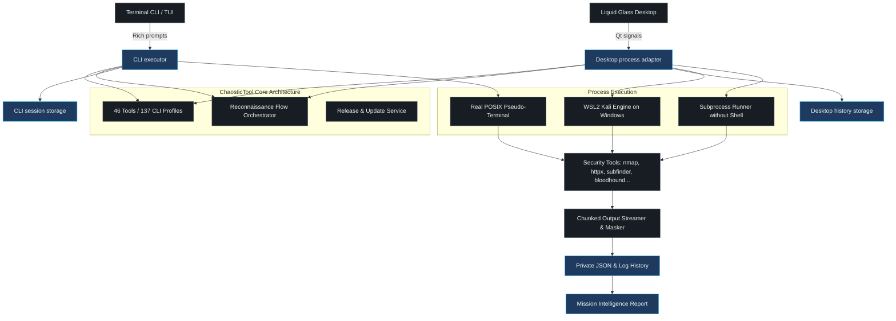

# Architecture

[Back to the README](../README.md)

ChaosticTool provides a rich terminal interface (CLI/TUI) and a frosted-glass Desktop
application in one source tree. They share the tool registry, phases, flows and release
version. Their process and storage adapters are still distinct while the neutral runner
is integrated; this document does not claim behavioural parity before the shared
scenarios pass.

## Source Map

| Path | Responsibility |
| --- | --- |
| [`chaostictool.py`](../chaostictool.py) | Unified command-line launcher, Rich terminal UI, profile runner, workflow dispatch |
| [`chaostic_desktop.py`](../chaostic_desktop.py) | Native desktop application entry point (`chaostictool-desktop`), Qt initialization |
| [`core/tools.py`](../core/tools.py) | Shared registry of 46 tools and 137 CLI profiles across ten phases |
| [`core/tool_manifest.py`](../core/tool_manifest.py) | Normalized installation contract for every catalog tool and supported platform/architecture |
| [`desktop/profiles.py`](../desktop/profiles.py) | Validation, normalization and secret redaction for Desktop launch forms |
| [`core/flows.py`](../core/flows.py) | Orchestrated reconnaissance workflows, step sequencing, and dependency resolution |
| [`core/executor.py`](../core/executor.py) | Subprocess control, real-time output streaming, secret redaction |
| [`core/runner.py`](../core/runner.py) | UI-neutral process contract used during CLI/Desktop convergence |
| [`core/backends/posix.py`](../core/backends/posix.py) | POSIX process-group lifecycle, bounded input and incremental output |
| [`core/terminal.py`](../core/terminal.py) | POSIX pseudo-terminal allocation and ANSI color terminal streaming |
| [`desktop/storage.py`](../desktop/storage.py) | Target persistence, deduplication, run history metadata, JSON Lines export |
| [`core/version.py`](../core/version.py) | Single source of truth for release version (`2.0.1`) |
| [`core/update_service.py`](../core/update_service.py) | GitHub release verification, cache throttling (once-a-day), package-manager detection |
| [`desktop/window.py`](../desktop/window.py) | Main Liquid Glass window, navigation stack, arsenal selector, run monitor |
| [`desktop/theme.py`](../desktop/theme.py) | Frosted-glass stylesheets, translucent palettes (light pastel & neon dark), typography |
| [`CMakeLists.txt`](../CMakeLists.txt) | Unified CPack packaging for Debian (`.deb`), Red Hat (`.rpm`), Arch, and AppImage |
| [`.github/workflows/ci.yml`](../.github/workflows/ci.yml) | Multi-OS build matrix, disposable container verification, release publishing |

## Reconnaissance Lifecycle

1. **Target Parsing & Canonicalization**: Network targets are resolved into IP addresses, CIDR subnets, hostnames, or URLs. Invalid hosts and shell injection characters are strictly rejected.
2. **Phase Sequencing**: A user selects an individual tool or an automated flow (e.g. *Full Discovery & Web Surface*). Profiles are organized across ten phases and flow steps are ordered deterministically.
3. **Execution & PTY Sandboxing**: Commands are executed directly as argument vectors without passing through a shell (`/bin/sh -c`). Interactive or color-aware tools are attached to a real pseudo-terminal (`pty`) with VT100 escape sequence parsing.
4. **Secret Masking & Output Streaming**: Terminal chunks are scanned in real time to redact credentials, API keys, and sensitive tokens before writing to disk.
5. **Atomic Persistence & History**: Run logs and JSON metadata are written to private user directories (`~/.local/share/chaostictool` on Linux, `%APPDATA%\ChaosticTool` on Windows). Symbolic links and directory traversal attempts are strictly refused during history cleanup.

## Process Interfaces

- `chaostictool`: Opens the interactive terminal interface on Linux.
- `chaostictool --check-installation`: Verifies runtime imports and user-data paths without root, network access, or tool installation.
- `chaostictool --check-updates`: Checks the latest public release without installing it.
- `chaostictool-desktop --smoke-test`: Executes an offscreen headless contract check confirming window construction, terminal rendering, and clean teardown.

Machine-readable catalog and non-interactive profile execution are planned interfaces;
they are not part of the current command-line contract.
